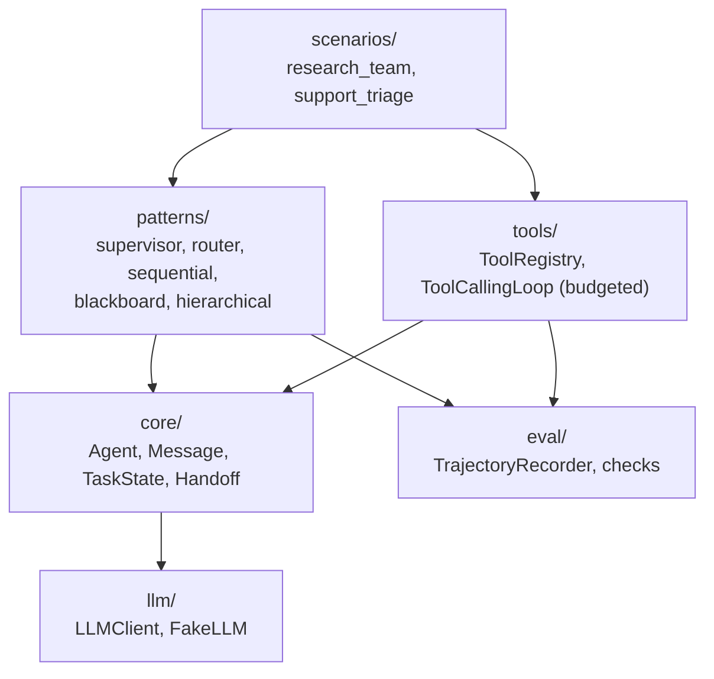

# Jagadish-multi-agent-orchestration

[](https://github.com/jagadishmazure-jpg/Jagadish-multi-agent-orchestration/actions/workflows/ci.yml)
[](https://github.com/jagadishmazure-jpg/Jagadish-multi-agent-orchestration/actions/workflows/codeql.yml)


**Multi-agent orchestration patterns as code: supervisor, router, sequential, blackboard and hierarchical, plus a budgeted tool-calling loop, a scripted fake LLM, trajectory recording and task-success checks. Offline.**

> Personal learning and portfolio project. Everything runs offline on synthetic,
> fictional data with no API keys. Nothing is deployed. Numbers in this README
> come from real runs and are re-checked by CI (`scripts/render_docs.py --check`).

## Recruiter summary

- Implements the five common ways to coordinate agents behind one small core (Agent, Message, TaskState, handoff) so they can be compared side by side.
- Real run: a planner, researcher, writer and critic pipeline produces an approved answer in 6 trajectory events; tickets route to billing, technical and account specialists; an unmatched ticket fails loudly instead of guessing.
- Deterministic offline tests, including failure modes; CI with lint, CodeQL, gitleaks and documented-output drift checks.

## Purpose

"Multi-agent" covers very different designs. This repo implements each common
pattern on the same core so the trade-offs are concrete: who decides the next
step, how work is handed off, and what happens when something fails. A scripted
`FakeLLM` keeps every run deterministic. Walkthroughs:
[docs/patterns.md](docs/patterns.md).

## Architecture



## How it works

| Pattern | Who decides | File |
|---|---|---|
| Supervisor | A lead agent splits the task and assigns workers | `orchestrator/patterns/supervisor.py` |
| Router | A classifier picks one specialist (`CATEGORY: <name>`) | `orchestrator/patterns/router.py` |
| Sequential | Fixed pipeline, each output feeds the next | `orchestrator/patterns/sequential.py` |
| Blackboard | Agents post to a shared board until DONE or a round limit | `orchestrator/patterns/blackboard.py` |
| Hierarchical | A top supervisor delegates to team supervisors | `orchestrator/patterns/hierarchical.py` |

`ToolCallingLoop` runs a ReAct-style loop with an iteration budget.
`TrajectoryRecorder` logs every step, and `orchestrator/eval/checks.py` checks
keywords, completed subtasks, errors, step budget and agents involved.

## Real code and output

```python
"""Research pipeline with checks, ticket triage through a router, and the iteration budget."""
from collections import Counter

from orchestrator.patterns import UnknownRouteError
from scenarios import run_research_scenario, triage_ticket

r = run_research_scenario()
rec = r["trajectory"]
print("Research pipeline agents:", " -> ".join(r["agents"]))
print("Trajectory events:", len(rec.events), dict(Counter(e.kind for e in rec.events)))
print("Final:", r["final"])
final_ok = all(k in r["final"] for k in ("Python", "Guido", "1991"))
print("Checks: keywords present:", final_ok, "| errors:", r["errors"] or "none")

for ticket in ("please refund my last invoice",
               "login error after update",
               "need to change my account email",
               "what are your opening hours?"):
    try:
        t = triage_ticket(ticket)
    except UnknownRouteError as e:
        print(f"Ticket '{ticket}' -> not routed: {e} (no default route, so it fails loudly)")
        continue
    print(f"Ticket '{ticket}' -> {t['category']} / {t['agent']}")
    print("   ", t["output"])

billing = triage_ticket("please refund my last invoice")["trajectory"]
print("Billing trajectory:", [(e.kind, e.agent) for e in billing.events])
```

Output of `python examples/demo.py` (real run, re-checked in CI):

<!-- run: python examples/demo.py -->
```text
Research pipeline agents: planner -> researcher -> writer -> critic
Trajectory events: 6 {'task_start': 1, 'step': 4, 'task_done': 1}
Final: CRITIC REVIEW: APPROVED. The Python article correctly names the creator (Guido van Rossum) and the release year (1991).
Checks: keywords present: True | errors: none
Ticket 'please refund my last invoice' -> billing / billing_specialist
    RESOLUTION: a refund of $89.97 will be credited to the original payment method within 5-7 days.
Ticket 'login error after update' -> technical / technical_specialist
    RESOLUTION: this matches known issue KB-1042. Please clear cookies and retry logging in.
Ticket 'need to change my account email' -> account / account_specialist
    RESOLUTION: your account email has been updated; a confirmation link is on its way.
Ticket 'what are your opening hours?' -> not routed: no specialist for 'general' (no default route, so it fails loudly)
Billing trajectory: [('classify', 'triage_classifier'), ('route', 'billing_specialist'), ('task_start', 'billing_specialist'), ('agent_reply', 'billing_specialist'), ('task_done', 'billing_specialist')]
```
<!-- /run -->

## How to run

```bash
git clone https://github.com/jagadishmazure-jpg/Jagadish-multi-agent-orchestration.git
cd Jagadish-multi-agent-orchestration
python -m pip install pytest      # no runtime dependencies (uv users: uv sync --group dev)
python -m pytest -q          # offline, no keys
python examples/demo.py
python scripts/render_docs.py --check   # documented output still matches
```

Test suite size (real collection, re-checked in CI):

<!-- run: python scripts/count_tests.py -->
```text
0 tests collected
```
<!-- /run -->

## Guardrails

- Tool loop has a hard iteration budget and raises `MaxIterationsError` when exceeded.
- Router and supervisor raise on unknown routes or workers instead of guessing (a default route is opt-in).
- Blackboard stops at a round limit and reports `converged=False`.
- Every run leaves a trajectory that the checks can assert on.

## Limitations

- All agents run on a scripted FakeLLM, so specialist answers are fixed scripts: the technical specialist always looks up the login KB entry, whatever the ticket says.
- The triage scenario has no default or human queue, so general questions raise `UnknownRouteError`.
- `evals/regression_research.yaml` documents the research checks, but the tests hard-code them rather than loading the file.
- No real LLM client implementation yet; `LLMClient` is the interface.
- No PyPI release; install from source.

## Built vs planned

| Capability | Status | Where |
|---|---|---|
| Core: Agent, Message, TaskState, Handoff | Built | `orchestrator/core/` |
| Five orchestration patterns | Built | `orchestrator/patterns/` |
| Budgeted tool-calling loop and stub tools | Built | `orchestrator/tools/` |
| Trajectory recorder and checks | Built | `orchestrator/eval/` |
| Two end-to-end scenarios | Built | `scenarios/` |
| Azure OpenAI `LLMClient` | Planned | docs/implementation-guide.md |
| Human handoff queue for unrouted tickets | Planned | not started |
| PyPI package | Planned | not started |

## Implementation guide

The step-by-step path from this offline build to an Azure deployment is in
[docs/implementation-guide.md](docs/implementation-guide.md). None of it has been
run; it is a plan.

## Related repositories

| Repo | How it relates |
|---|---|
| [Jagadish-event-driven-agents](https://github.com/jagadishmazure-jpg/Jagadish-event-driven-agents) | Choreographed agents on an event bus instead of orchestration |
| [Jagadish-deep-agents](https://github.com/jagadishmazure-jpg/Jagadish-deep-agents) | One agent that plans, replans and remembers |
| [Jagadish-llm-evals-observability](https://github.com/jagadishmazure-jpg/Jagadish-llm-evals-observability) | Judges and tracing for these runs |
| [Jagadish-agent-security-redteam](https://github.com/jagadishmazure-jpg/Jagadish-agent-security-redteam) | Attacks and defences around tool-using agents |
| [Jagadish-food-ingredients-agentic-ai](https://github.com/jagadishmazure-jpg/Jagadish-food-ingredients-agentic-ai) | A larger multi-agent system on Azure |

## Documentation

- [Pattern walkthroughs](docs/patterns.md)
- [Implementation guide (Azure)](docs/implementation-guide.md)
- [Interview points](docs/interview-points.md)
- [Security policy](SECURITY.md)

## Project layout

```
orchestrator/
  core/      Agent, Message, TaskState, Handoff
  patterns/  supervisor, router, sequential, blackboard, hierarchical
  tools/     ToolRegistry, ToolCallingLoop, stub tools
  llm/       LLMClient interface, FakeLLM
  eval/      TrajectoryRecorder, checks
scenarios/   research_team, support_triage
evals/       regression_research.yaml (documented expectations)
examples/demo.py  the run shown above
tests/       offline pytest suite, including failure modes
```

## License

MIT, see [LICENSE](LICENSE). All data is synthetic; every organisation and person is fictional.
