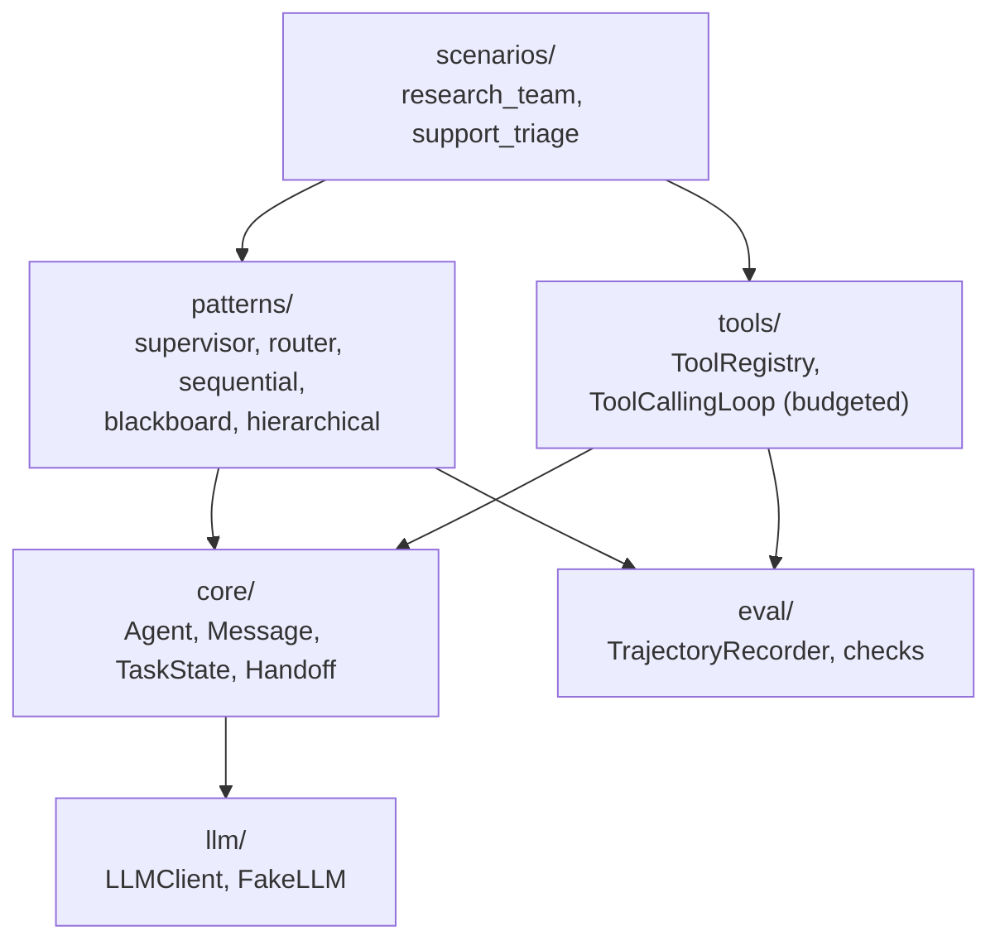

# Jagadish-multi-agent-orchestration

[](https://github.com/jagadishmazure-jpg/Jagadish-multi-agent-orchestration/actions/workflows/ci.yml)
[](https://github.com/jagadishmazure-jpg/Jagadish-multi-agent-orchestration/actions/workflows/codeql.yml)


**Multi-agent orchestration patterns as code: supervisor, router, sequential, blackboard and hierarchical, plus a budgeted tool-calling loop, a scripted fake LLM, trajectory recording and task-success checks. Offline.**

> Personal learning and portfolio project. Everything runs offline on synthetic,
> fictional data with no API keys. Nothing is deployed. Numbers in this README
> come from real runs and are re-checked by CI (`scripts/render_docs.py --check`).

## Recruiter summary

- Implements the five common ways to coordinate agents behind one small core (Agent, Message, TaskState, handoff) so they can be compared side by side.
- Real run: a planner, researcher, writer and critic pipeline produces an approved answer in 6 trajectory events; tickets route to billing, technical and account specialists; an unmatched ticket fails loudly instead of guessing.
- Deterministic offline tests, including failure modes; CI with lint, CodeQL, gitleaks and documented-output drift checks.
- The same research-and-report task runs as a CrewAI crew, a LangGraph graph, and a Microsoft Agent Framework workflow, scored on one golden set. Plan-and-execute and ReWOO are compared with ReAct. The crew speaks A2A. Mock LLM by default; Azure OpenAI when its env vars are set.

## Purpose

"Multi-agent" covers very different designs. This repo implements each common
pattern on the same core so the trade-offs are concrete: who decides the next
step, how work is handed off, and what happens when something fails. A scripted
`FakeLLM` keeps every run deterministic. Walkthroughs:
[docs/patterns.md](docs/patterns.md).

## Architecture



## How it works

| Pattern | Who decides | File |
|---|---|---|
| Supervisor | A lead agent splits the task and assigns workers | `orchestrator/patterns/supervisor.py` |
| Router | A classifier picks one specialist (`CATEGORY: <name>`) | `orchestrator/patterns/router.py` |
| Sequential | Fixed pipeline, each output feeds the next | `orchestrator/patterns/sequential.py` |
| Blackboard | Agents post to a shared board until DONE or a round limit | `orchestrator/patterns/blackboard.py` |
| Hierarchical | A top supervisor delegates to team supervisors | `orchestrator/patterns/hierarchical.py` |

`ToolCallingLoop` runs a ReAct-style loop with an iteration budget.
`TrajectoryRecorder` logs every step, and `orchestrator/eval/checks.py` checks
keywords, completed subtasks, errors, step budget and agents involved.

Plan-and-execute (planner, executor, replanner) and ReWOO sit next to that
ReAct loop in `orchestrator/patterns/`. The research task is also implemented
as a CrewAI crew, a LangGraph `StateGraph`, and a Microsoft Agent Framework
sequential workflow in `orchestrator/frameworks/`. The crew publishes an A2A
agent card and joins the in-process mesh in `orchestrator/a2a/`. This repo did
not already have a mesh.

## Real code and output

```python
"""Research pipeline with checks, ticket triage through a router, and the iteration budget."""
from collections import Counter

from orchestrator.patterns import UnknownRouteError
from scenarios import run_research_scenario, triage_ticket

r = run_research_scenario()
rec = r["trajectory"]
print("Research pipeline agents:", " -> ".join(r["agents"]))
print("Trajectory events:", len(rec.events), dict(Counter(e.kind for e in rec.events)))
print("Final:", r["final"])
final_ok = all(k in r["final"] for k in ("Python", "Guido", "1991"))
print("Checks: keywords present:", final_ok, "| errors:", r["errors"] or "none")

for ticket in ("please refund my last invoice",
               "login error after update",
               "need to change my account email",
               "what are your opening hours?"):
    try:
        t = triage_ticket(ticket)
    except UnknownRouteError as e:
        print(f"Ticket '{ticket}' -> not routed: {e} (no default route, so it fails loudly)")
        continue
    print(f"Ticket '{ticket}' -> {t['category']} / {t['agent']}")
    print("   ", t["output"])

billing = triage_ticket("please refund my last invoice")["trajectory"]
print("Billing trajectory:", [(e.kind, e.agent) for e in billing.events])
```

Output of `python examples/demo.py` (real run, re-checked in CI):

<!-- run: python examples/demo.py -->
```text
Research pipeline agents: planner -> researcher -> writer -> critic
Trajectory events: 6 {'task_start': 1, 'step': 4, 'task_done': 1}
Final: CRITIC REVIEW: APPROVED. The Python article correctly names the creator (Guido van Rossum) and the release year (1991).
Checks: keywords present: True | errors: none
Ticket 'please refund my last invoice' -> billing / billing_specialist
    RESOLUTION: a refund of $89.97 will be credited to the original payment method within 5-7 days.
Ticket 'login error after update' -> technical / technical_specialist
    RESOLUTION: this matches known issue KB-1042. Please clear cookies and retry logging in.
Ticket 'need to change my account email' -> account / account_specialist
    RESOLUTION: your account email has been updated; a confirmation link is on its way.
Ticket 'what are your opening hours?' -> not routed: no specialist for 'general' (no default route, so it fails loudly)
Billing trajectory: [('classify', 'triage_classifier'), ('route', 'billing_specialist'), ('task_start', 'billing_specialist'), ('agent_reply', 'billing_specialist'), ('task_done', 'billing_specialist')]
```
<!-- /run -->

## Same research task, three frameworks

The golden set is `evals/golden_research.json` (three topics; the Python case
is the same article as `scenarios/research_team.py`). Each runner does four
steps: plan, findings, draft, review. Quality is the share of required
keywords in an approved review. Tokens are estimated at one per four
characters. Mock latency is 5 ms per LLM completion, so a four-call pipeline
ties; prompt tokens and code size do not.

LangGraph passes only the previous stage into the next node. Agent Framework
forwards the growing conversation. CrewAI repeats the role, goal, and
backstory on every task. Code size counts non-blank, non-comment lines in
that framework's module.

<!-- run: python examples/compare_frameworks.py -->
```text
Framework comparison (mock LLM, deterministic latency = 5 ms/call)
backend: builtin. The same specs run on crewai, langgraph, and agent-framework when those packages are installed.
framework        quality  prompt_tokens  completion_tokens  total_tokens  latency_ms  llm_calls  code_lines  cases  runtime
---------------  -------  -------------  -----------------  ------------  ----------  ---------  ----------  -----  -------
crewai           1.00     1466           359                1825          60          12         249         3/3    builtin
langgraph        1.00     784            359                1143          60          12         90          3/3    builtin
agent_framework  1.00     1072           359                1431          60          12         147         3/3    builtin

Live results (Azure OpenAI): not recorded in this run.
Set AZURE_OPENAI_ENDPOINT, AZURE_OPENAI_API_KEY, and AZURE_OPENAI_DEPLOYMENT, then run:
  python examples/compare_frameworks.py --live
framework        quality  total_tokens  latency_ms  cases
---------------  -------  ------------  ----------  -----
crewai           -        -             -           -
langgraph        -        -             -           -
agent_framework  -        -             -           -
```
<!-- /run -->

With `crewai`, `langgraph`, and `agent-framework` installed
(`pip install -e '.[frameworks]'`), the same specs execute as a real `Crew`,
`StateGraph`, and `SequentialBuilder`. The table above is the builtin engine
so the numbers do not depend on those packages. Live Azure rows stay blank
until `python examples/compare_frameworks.py --live`.

## Plan-and-execute, ReWOO, and ReAct

Three multi-step tasks in `orchestrator/patterns/tasks.py` (sum of two capital
populations, twice Canberra's population, Python's creator and year). ReAct is
the existing budgeted tool loop. Plan-and-execute is its own graph: planner,
then executor, then replanner, and the replanner may extend an incomplete
plan. ReWOO writes every tool call up front (`#E1 = search[...]`), runs the
tools with no model in between, then solves. On the mock, ReWOO uses the
fewest calls and plan-and-execute the most, because it replans after every
step.

<!-- run: python examples/compare_control.py -->
```text
Control-pattern comparison (mock LLM, deterministic latency = 5 ms/call)
patterns: react (existing tool loop), plan_execute (planner/executor/replanner), rewoo
pattern       success_rate  prompt_tokens  completion_tokens  total_tokens  latency_ms  llm_calls  tasks  runtime
------------  ------------  -------------  -----------------  ------------  ----------  ---------  -----  ---------
react         1.00          897            115                1012          65          13         3/3    tool_loop
plan_execute  1.00          1823           237                2060          115         23         3/3    builtin
rewoo         1.00          381            113                494           30          6          3/3    builtin

Live results (Azure OpenAI): not recorded in this run.
Set AZURE_OPENAI_ENDPOINT, AZURE_OPENAI_API_KEY, and AZURE_OPENAI_DEPLOYMENT, then run:
  python examples/compare_control.py --live
pattern       success_rate  total_tokens  latency_ms  tasks
------------  ------------  ------------  ----------  -----
react         -             -             -           -
plan_execute  -             -             -           -
rewoo         -             -             -           -
```
<!-- /run -->

Live rows are filled by `python examples/compare_control.py --live` when
Azure OpenAI is configured. They are blank here.

## A2A research crew

`publish_research_crew` registers the crew on `AgentMesh`. A mesh that speaks
A2A can also `GET /.well-known/agent-card.json` and `POST` `message/send`.

<!-- run: python examples/a2a_research.py -->
```text
mesh agents: Research Crew
card: Research Crew
skill: research-and-report
state: completed
approved: True
```
<!-- /run -->

## How to run

```bash
git clone https://github.com/jagadishmazure-jpg/Jagadish-multi-agent-orchestration.git
cd Jagadish-multi-agent-orchestration
python -m pip install pytest      # no runtime dependencies (uv users: uv sync --group dev)
python -m pytest -q          # offline, no keys
python examples/demo.py
python examples/compare_frameworks.py
python examples/compare_control.py
python examples/a2a_research.py
python scripts/render_docs.py --check   # documented output still matches
# optional, to execute the real Crew / StateGraph / SequentialBuilder:
# python -m pip install -e '.[frameworks]'
```

Test suite size (real collection, re-checked in CI):

<!-- run: python scripts/count_tests.py -->
```text
152 tests collected
```
<!-- /run -->

## Guardrails

- Tool loop has a hard iteration budget and raises `MaxIterationsError` when exceeded.
- Router and supervisor raise on unknown routes or workers instead of guessing (a default route is opt-in).
- Blackboard stops at a round limit and reports `converged=False`.
- Every run leaves a trajectory that the checks can assert on.

## Limitations

- All agents run on a scripted model by default, so specialist answers are fixed scripts: the technical specialist always looks up the login KB entry, whatever the ticket says. The framework and control comparisons are scripted the same way, which is why quality and success rate tie.
- Mock latency is 5 ms per completion, not wall-clock time. The research frameworks each make 12 calls, so their latency ties; tokens and code size do not.
- Azure OpenAI (`orchestrator/llm/azure.py`) is used when `AZURE_OPENAI_ENDPOINT`, `AZURE_OPENAI_API_KEY`, and `AZURE_OPENAI_DEPLOYMENT` are all set. CI never calls it. The live rows in the tables are the place for that run (`--live`).
- The triage scenario has no default or human queue, so general questions raise `UnknownRouteError`.
- `evals/regression_research.yaml` documents the research checks, but those tests hard-code them. The new golden set in `evals/golden_research.json` is loaded by the comparison.
- There was no agent mesh in the repo. The crew joins the in-process `AgentMesh` and publishes an A2A card.
- No PyPI release; install from source. Optional extra: `.[frameworks]`.

## Built vs planned

| Capability | Status | Where |
|---|---|---|
| Core: Agent, Message, TaskState, Handoff | Built | `orchestrator/core/` |
| Five orchestration patterns | Built | `orchestrator/patterns/` |
| Budgeted tool-calling loop and stub tools | Built | `orchestrator/tools/` |
| Trajectory recorder and checks | Built | `orchestrator/eval/` |
| Two end-to-end scenarios | Built | `scenarios/` |
| Research task on CrewAI, LangGraph, and Agent Framework | Built | `orchestrator/frameworks/` |
| Golden set and comparison harness | Built | `evals/golden_research.json` |
| Plan-and-execute and ReWOO, compared with ReAct | Built | `orchestrator/patterns/` |
| A2A research crew and in-process mesh | Built | `orchestrator/a2a/` |
| Azure OpenAI `LLMClient` | Built, not called in CI | `orchestrator/llm/azure.py` |
| Human handoff queue for unrouted tickets | Planned | not started |
| PyPI package | Planned | not started |

## Implementation guide

The step-by-step path from this offline build to an Azure deployment is in
[docs/implementation-guide.md](docs/implementation-guide.md). None of it has been
run; it is a plan.

## Related repositories

| Repo | How it relates |
|---|---|
| [Jagadish-event-driven-agents](https://github.com/jagadishmazure-jpg/Jagadish-event-driven-agents) | Choreographed agents on an event bus instead of orchestration |
| [Jagadish-deep-agents](https://github.com/jagadishmazure-jpg/Jagadish-deep-agents) | One agent that plans, replans and remembers |
| [Jagadish-llm-evals-observability](https://github.com/jagadishmazure-jpg/Jagadish-llm-evals-observability) | Judges and tracing for these runs |
| [Jagadish-agent-security-redteam](https://github.com/jagadishmazure-jpg/Jagadish-agent-security-redteam) | Attacks and defences around tool-using agents |
| [Jagadish-food-ingredients-agentic-ai](https://github.com/jagadishmazure-jpg/Jagadish-food-ingredients-agentic-ai) | A larger multi-agent system on Azure |

## Documentation

- [Pattern walkthroughs](docs/patterns.md)
- [Implementation guide (Azure)](docs/implementation-guide.md)
- [Interview points](docs/interview-points.md)
- [Security policy](SECURITY.md)

## Project layout

```
orchestrator/
  core/        Agent, Message, TaskState, Handoff
  patterns/    five orchestration patterns, plus plan-and-execute, ReWOO, ReAct
  frameworks/  CrewAI, LangGraph, and Agent Framework research runners
  a2a/         agent card, JSON-RPC, in-process mesh
  tools/       ToolRegistry, ToolCallingLoop, stub tools
  llm/         LLMClient, FakeLLM, meter, Azure OpenAI client
  eval/        TrajectoryRecorder, checks
scenarios/     research_team, support_triage
evals/         regression_research.yaml, golden_research.json
examples/      demo.py, compare_frameworks.py, compare_control.py, a2a_research.py
tests/         offline pytest suite, including failure modes
```

## License

MIT, see [LICENSE](LICENSE). All data is synthetic; every organisation and person is fictional.
